<!--
  GitHub Profile README for @sachin-lolariya
  Replace or remove any project link that is no longer live before publishing.
-->

  

<h1 align="center">Hi, I'm Sachin Lolariya 👋</h1>

  <strong>Website Developer · WordPress Developer · Software Developer</strong>

  I build responsive websites and turn design concepts into practical web experiences.
  I enjoy working with front-end technologies and creating dynamic WordPress websites.

  <a href="https://github.com/sachin-lolariya">GitHub</a>
  &nbsp;·&nbsp;
  <a href="https://www.atracindustries.com/">Atrac Industries project</a>
  &nbsp;·&nbsp;
  <a href="https://uratomepower.com/">Ur atom Epower project</a>

---

## `01` / About

- 💻 Focused on responsive website development and WordPress.
- 🧩 Convert UI designs into clean, responsive pages using HTML, CSS, JavaScript and Bootstrap.
- ⚙️ Build and customize dynamic WordPress websites using reusable content components, including Lazy Blocks and SCF.
- 🎓 Currently pursuing a Bachelor of Computer Applications (BCA).
- 🌱 Improving my development workflow through practical projects and continuous learning.

## `02` / Tech Stack

  
  
  
  
  
  

**WordPress workflow:** Custom page building · Lazy Blocks · SCF · Dynamic content management

## `03` / Selected Work

### Atrac Industries — Responsive Website

Worked on the website UI and responsive front-end implementation during my web development internship.

- Focus: UI implementation and responsive layouts
- Technologies: HTML5, CSS3, Bootstrap, WordPress
- Website: [atracindustries.com](https://www.atracindustries.com/)

### Ur atom Epower — WordPress Website

A WordPress website project involving front-end and dynamic website implementation.

- Focus: WordPress website development and customization
- Website: [uratomepower.com](https://uratomepower.com/)

### Udaan Wings — In Progress

A WordPress website project currently in development. More details will be added when the project is ready to share.

> These project notes describe the work shared so far. Add repository links, screenshots and specific contributions as each project is published and verified.

## `04` / Currently Exploring

- Building reusable WordPress components and dynamic content structures.
- Improving JavaScript fundamentals and responsive UI implementation.
- Learning to manage projects with Git and GitHub.

## `05` / GitHub Activity

This profile is new, so the contribution graph and repository list will grow as I publish code and document projects. I prefer showing genuine activity rather than displaying unverified statistics.

## `06` / Let's Connect

I'm interested in learning, building useful websites and collaborating on practical web development projects.

  

  

