<div align="center">
  
</div>

<br />

<div align="center">

> *Building clean, responsive, and user-friendly web experiences with a focus on practical development and thoughtful design.*

<br />

[](https://github.com/sachin-lolariya)
&nbsp;
[](https://www.linkedin.com/in/sachin-lolariya-a8a6b3275/)
&nbsp;
[](mailto:sachinlolariya3@gmail.com)

</div>

<br />

---

### `01` / About Me

<table>
  <tr>
    <td width="130" align="center" valign="middle">
      
    </td>
    <td>
      I am a passionate <strong>Web Developer and Web Designer</strong> dedicated to building clean, responsive, and user-friendly websites. I enjoy bridging visual design with practical code to create seamless, enjoyable web experiences that adapt cleanly across devices.
      <br /><br />
      With a strong foundation in core web standards and structured programming, I bring creativity, an organized approach to development workflows, and quick adaptability when learning new tools and tackling technical challenges.
    </td>
  </tr>
</table>

---

### `02` / Education

```
┌────────────────────────────────────────────────────────────────────────┐
│  ACADEMIC BACKGROUND                                                   │
├────────────────────────────────────────────────────────────────────────┤
│  • BCA (Bachelor of Computer Applications) — FY Running                │
│  • S.S.C & H.S.C                                                       │
└────────────────────────────────────────────────────────────────────────┘
```

---

### `03` / Technical Skills

#### Development
<p align="left">
  
  
  
  
  
  
</p>

#### UI & Frameworks
<p align="left">
  
  
  
</p>

* **CMS & Content Architecture:** Custom WordPress site building, component-based page creation (Lazy Blocks, SCF), dynamic template structures.
* **Core Practices:** Semantic HTML, modular CSS styling, clean DOM scripting, cross-browser compatibility.

---

### `04` / Strengths

| Core Competency | Description |
| :--- | :--- |
| **Creativity** | Blending visual balance, typography, and functional layouts for modern interfaces. |
| **Teamwork** | Collaborative communication, receptive to feedback, and goal-oriented. |
| **Organization** | Clean directory structures, maintainable code, and methodical development habits. |
| **Time Management** | Disciplined execution focused on meeting project deadlines reliably. |
| **Quick Adaptability** | Fast learner, eager to explore emerging web technologies and modern best practices. |

---

### `05` / GitHub Activity & Contributions

<div align="center">
  <picture>
    <source media="(prefers-color-scheme: dark)" srcset="https://raw.githubusercontent.com/sachin-lolariya/sachin-lolariya/output/github-contribution-grid-snake-dark.svg" />
    <source media="(prefers-color-scheme: light)" srcset="https://raw.githubusercontent.com/sachin-lolariya/sachin-lolariya/output/github-contribution-grid-snake.svg" />
    
  </picture>
</div>

<br />

> *I believe in displaying genuine development work rather than artificial vanity metrics. This profile represents an active, growing foundation where projects, code repositories, and documentation are shared transparently as they are built.*

* Explore my code repositories: **[github.com/sachin-lolariya?tab=repositories](https://github.com/sachin-lolariya?tab=repositories)**
* Actively building practical web applications, refining component architectures, and deepening JavaScript and backend capabilities.

---

### `06` / Languages

* **English** — Professional working proficiency
* **Hindi** — Native / Fluent
* **Gujarati** — Native / Fluent

---

### `07` / Let's Connect

Whether you have an interesting web project, an internship opportunity, or simply want to talk about clean web development and design:

* **GitHub:** [@sachin-lolariya](https://github.com/sachin-lolariya)
* **LinkedIn:** [linkedin.com/in/sachin-lolariya-a8a6b3275](https://www.linkedin.com/in/sachin-lolariya-a8a6b3275/)
* **Email:** [sachinlolariya3@gmail.com](mailto:sachinlolariya3@gmail.com)

<br />

<div align="center">
  
</div>
